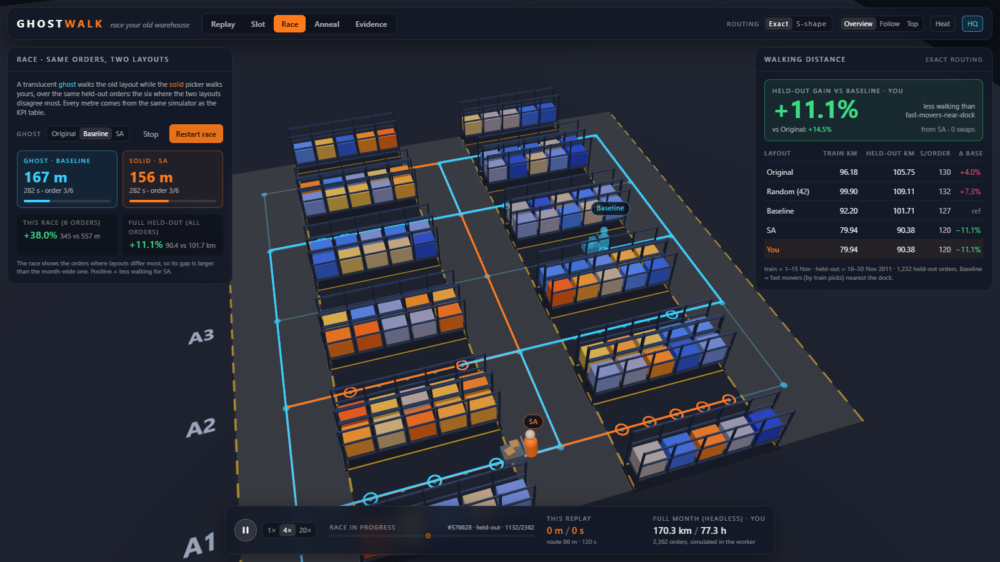
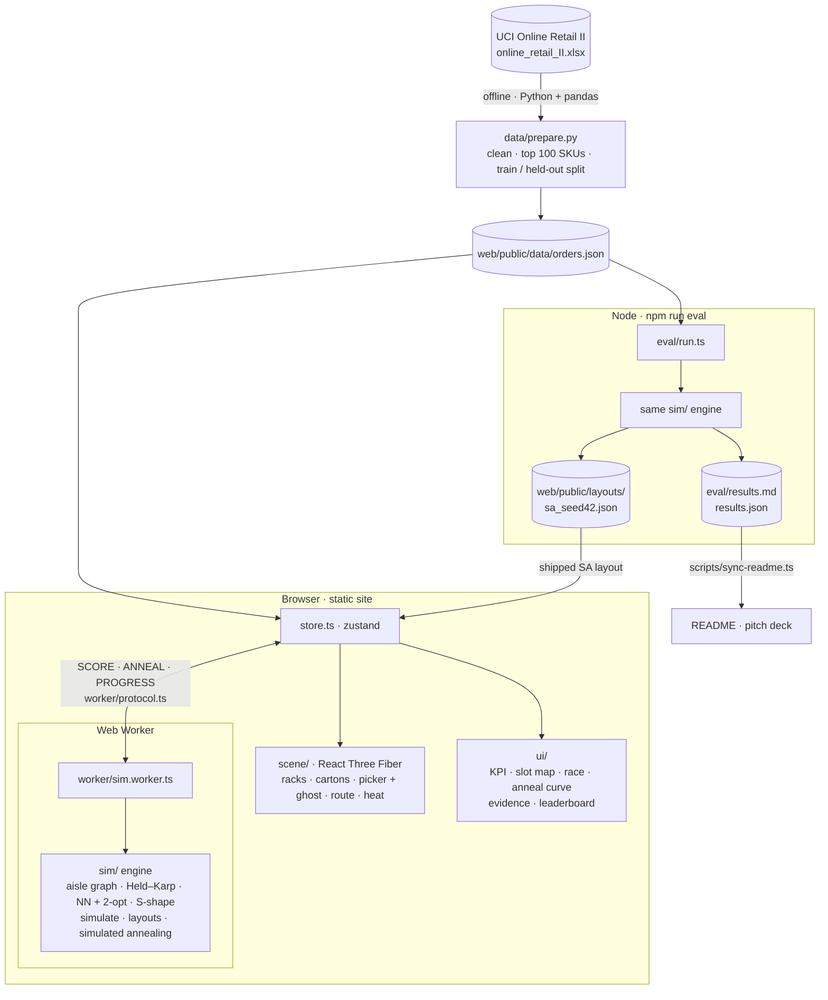
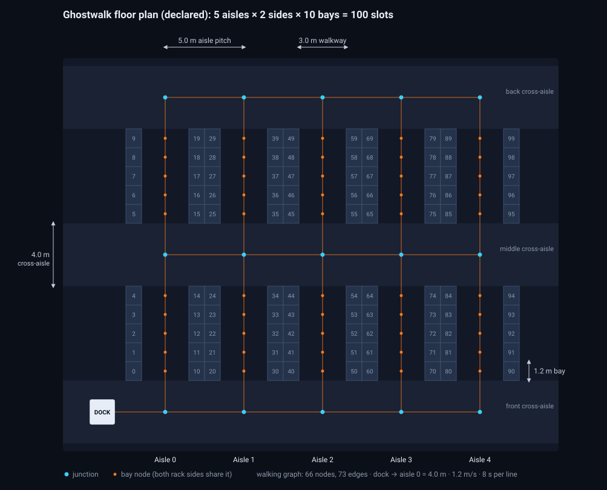

# Ghostwalk: race your old warehouse

**NexAI Hack 2026 · Problem 4.2 · Warehouse Digital Twin: 3D Picking Floor Game**

**The problem.** Pickers can spend more of a shift walking than picking, and where each product sits (its *slot*) decides how far they walk. PS 4.2 asks for a browser 3D twin of a picking floor, driven by real orders, where the player re-slots products and the twin shows the walking saved. The gain must be *measured, not claimed*.

**What you see.** A 3D picking floor that replays one real month of orders: 2,362 invoices from UCI Online Retail II, November 2011. A translucent **ghost** picker walks the layout the problem statement tells us to beat, fast movers nearest the dock (**Baseline**). A solid picker walks the layout found by our simulated-annealing optimiser, or your own. Both walk the same orders along the aisles, each with its own distance and time counters. You can swap cartons yourself, and every swap is re-scored in a Web Worker.



**Result.** All layouts are built from orders of 1–15 Nov and scored on **held-out** orders of 16–30 Nov:

<!-- sync:headline -->
_Headline (held-out = orders 16–30 Nov 2011, never seen by Baseline ranking or SA). Copied from [`eval/results.md`](eval/results.md) by `scripts/sync-readme.ts`._

- **SA vs Baseline, held-out walking distance: −11.1%** (101.71 km → 90.40 km)
- SA vs Baseline on train (in-sample): −13.3%, so in-sample → held-out shrinkage is 2.2 percentage points
- Baseline vs Original, held-out: −3.8% (105.75 km → 101.71 km)
- SA over seeds 42, 43, 44, 45, 46 (all at 30,000 iterations; seed 42 was fixed before the run): held-out Δ vs Baseline −10.0% ± 1.2 pp (mean ± sd)
- Train-only means train-only: Baseline ranks SKUs by 1–15 Nov picks (ties by StockCode), SA scores train orders only. The top-100 SKU set itself is chosen on the full month by `data/prepare.py` (see Dataset).
<!-- /sync:headline -->

| | |
|---|---|
| **Live app** | _pending the Vercel deploy (tracked in #7)_ |
| **Video overview** | _pending (≤ 3 min, tracked in #11)_ |
| **Dev log** | [DEV_LOG.md](DEV_LOG.md): decisions, AI assistance, experiments, rejected approaches |
| **Data** | UCI Online Retail II (Chen, 2019), [CC BY 4.0](https://creativecommons.org/licenses/by/4.0/); full credit in [Data](#data) |
| **AI tools** | [Claude Code](https://claude.com/claude-code) (Anthropic), declared in [Tech stack](#tech-stack-and-declared-tools) and [DEV_LOG.md](DEV_LOG.md) |
| **Docs** | [docs/architecture.md](docs/architecture.md) · [docs/BUILD_SPEC.md](docs/BUILD_SPEC.md) · [docs/MASTER_PLAN.md](docs/MASTER_PLAN.md) |

**Run it and check the numbers** (Node.js 20.19+ or 22.12+):

```bash
cd web
npm ci
npm run dev                                 # http://localhost:5173
npm run test                                # vitest: routing exactness, rack-free paths, determinism, store + worker, leaderboard
npm run eval                                # same engine in Node -> eval/results.md, the source of every number above
npx tsx ../scripts/sync-readme.ts --check   # exits 1 if this README differs from eval/results.md
```

No backend, no API keys, no cold start: the app is a static Vite site, and all scoring runs in a Web Worker on your machine.

---

## What Ghostwalk does

| Mode | What you see |
|---|---|
| **Replay** | An order from the month plays back in 3D. The picker leaves the dock, walks the aisles (never through racks) to each slot, pauses for each pick, and returns. Distance and time counters tick as it goes. You can flip the routing between **Exact** (optimal tour) and **S-shape** (what a human picker typically walks). |
| **Slot** | Click a carton, then another, to swap them, in 3D or on the 2D slot map. The KPI card re-scores your layout on the train *and* held-out orders. **Baseline** puts the fast movers nearest the dock. Undo, and start from Original, Baseline or the SA layout. |
| **Race** | The ghost (Original, Baseline or SA; by default the layout you started from) and the solid picker (your current layout) walk the same six held-out orders: the ones where the two layouts differ most. Both are labelled on screen, each with its own counters. The panel shows the gap on those six orders and on the full held-out set. |
| **Anneal** | The simulated-annealing opponent runs live in the worker from your current layout (seed and 1k / 3k / 10k iterations). Cartons fly as swaps are accepted, and the train-km curve draws itself against dashed Baseline and shipped-SA reference lines. The shipped SA layout (seed 42, 30,000 iterations from Baseline) comes from `npm run eval`. |
| **Evidence** | Data cleaning counts, the held-out table, exact vs heuristic routing share, the policy ablation, ms per re-score, seed and commit hash, assumptions and limitations. |
| **Heatmap / Leaderboard** | Floor tiles show rack visits. The leaderboard saves your layouts with held-out km, Δ vs Baseline, provenance and commit, and exports them to JSON. |

### PS 4.2 requirements

| Requirement | Where |
|---|---|
| Must 1: turn one month of order lines into JSON (top ~100 products, pick counts, orders) | [`data/prepare.py`](data/prepare.py) → `web/public/data/orders.json` |
| Must 2: 3D grid warehouse (racks, aisles, dock, animated picker) replaying orders along aisles, with live distance and time counters | `web/src/scene/` + replay HUD in `web/src/ui/` |
| Must 3: swap products, replay the same orders, before/after distance and pick time, automatic fast-movers baseline | Slot mode, KPI card, Race, Baseline button |
| Stretch: heatmap of rack visits | `web/src/scene/HeatTiles.tsx` |
| Stretch: leaderboard of player layouts | [`web/src/ui/Leaderboard.tsx`](web/src/ui/Leaderboard.tsx) |
| Extra: optimiser opponent (simulated annealing) | `web/src/sim/slotting.ts` |
| Stretch, not built: batch picking, several pickers with congestion | cut, see [BUILD_SPEC §10](docs/BUILD_SPEC.md) |

## How scoring stays honest

- **Held-out split.** Orders from 1–15 Nov 2011 are **train**: the player, the heatmap and the optimiser see them. Orders from 16–30 Nov are **held-out** and are used only for scoring. The headline KPI is the **held-out gain vs Baseline**. The gain vs Original is shown second and labelled as such.
- **References that are hard to game.** *Original* is catalogue order (SKUs in StockCode order, aisle by aisle: what a warehouse does when nobody slots). *Random (seed 42)* is a second reference row, so no gain depends on a convenient convention. *Baseline* (fast movers nearest the dock, ranked by **train** picks, ties broken by StockCode) is the layout to beat.
- **Exact routing, with its limits stated.** Every tour runs on the aisle graph. Orders with ≤ 11 distinct bay stops (12 nodes including the dock) are routed exactly with Held–Karp dynamic programming. Larger orders use nearest-neighbour + 2-opt and are flagged. The Evidence panel prints how many orders, and what share of the metres, were routed exactly.
- **Deterministic.** The simulator never calls `Math.random` or `Date.now`. The PRNG is mulberry32 with the seed shown in the UI. The annealing budget is counted in **iterations, not seconds**, so the same seed gives the same layout on any machine.
- **One simulator everywhere.** The worker, the 3D playback and `npm run eval` all import the same `web/src/sim/`. The animation only plays back paths the simulator produced. The README and the deck quote `eval/results.md` and never retype a number.

## Results

<!-- sync:results -->
_Copied from [`eval/results.md`](eval/results.md) by `scripts/sync-readme.ts`; only heading levels are changed._

### Ghostwalk evaluation results

Generated by `npm run eval` (`eval/run.ts`, Node v25.2.1) at commit `7aba833`.
Same `web/src/sim` code the app runs in its worker. Every number below is produced by that run; nothing is typed by hand.

#### Headline (held-out = orders 16–30 Nov 2011, never seen by Baseline ranking or SA)

- **SA vs Baseline, held-out walking distance: −11.1%** (101.71 km → 90.40 km)
- SA vs Baseline on train (in-sample): −13.3%, so in-sample → held-out shrinkage is 2.2 percentage points
- Baseline vs Original, held-out: −3.8% (105.75 km → 101.71 km)
- SA over seeds 42, 43, 44, 45, 46 (all at 30,000 iterations; seed 42 was fixed before the run): held-out Δ vs Baseline −10.0% ± 1.2 pp (mean ± sd)
- Train-only means train-only: Baseline ranks SKUs by 1–15 Nov picks (ties by StockCode), SA scores train orders only. The top-100 SKU set itself is chosen on the full month by `data/prepare.py` (see Dataset).

#### Layouts, exact routing policy

| Layout | Train km | Held-out km | Train s/order | Held-out s/order | Δ held-out vs Baseline | Δ train vs Baseline |
|---|---:|---:|---:|---:|---:|---:|
| Original (catalogue order) | 96.18 | 105.75 | 127.9 | 130.0 | +4.0% | +4.3% |
| Random (seed 42) | 99.90 | 109.11 | 130.7 | 132.3 | +7.3% | +8.4% |
| Baseline (fast movers nearest dock) | 92.20 | 101.71 | 125.0 | 127.3 | — | — |
| SA (seed 42, 30,000 it, from Baseline, train only) | 79.91 | 90.40 | 116.0 | 119.6 | −11.1% | −13.3% |

Time model: seconds = metres / 1.2 m/s + 8 s per order line (declared, synthetic).

#### Ablation: S-shape routing policy (what a human picker does)

| Layout | Train km | Held-out km | Held-out s/order | S-shape vs exact, held-out | Δ held-out vs Baseline (S-shape) |
|---|---:|---:|---:|---:|---:|
| Original (catalogue order) | 115.46 | 127.60 | 144.8 | +20.7% | +2.9% |
| Baseline (fast movers nearest dock) | 111.89 | 123.95 | 142.3 | +21.9% | — |
| SA (seed 42, 30,000 it, from Baseline, train only) | 96.45 | 109.33 | 132.4 | +20.9% | −11.8% |

SA optimises exact-policy metres; the S-shape rows show whether the gain survives a cruder picker.

#### Routing honesty (full month, exact policy)

Orders with ≤ 11 distinct stops (12 nodes incl. dock) are solved exactly with Held–Karp; larger ones use nearest neighbour + 2-opt (also seeded from the S-shape sequence), flagged per order.

| Layout | Exact orders | Heuristic orders | Share of metres routed exactly |
|---|---:|---:|---:|
| Original (catalogue order) | 2025 | 337 | 78.4% |
| Random (seed 42) | 2027 | 335 | 78.3% |
| Baseline (fast movers nearest dock) | 2041 | 321 | 78.2% |
| SA (seed 42, 30,000 it, from Baseline, train only) | 2094 | 268 | 80.9% |

Heuristic quality where the app actually uses it (Baseline layout, orders with 12–16 stops, checked offline against an independent Held–Karp in eval/run.ts): 172 orders; the route the simulator reports was optimal on 101 (58.7%); **1.63% excess over optimal in total metres**, mean 1.61% per order, worst 9.3%. 149 heuristic orders have more than 16 stops (up to 48) and are not checked.

Sanity check on small orders only (2–11 stops, which the app always routes with Held–Karp, so this does not describe shipped routes): NN + 2-opt alone matched Held–Karp on 1563 of 1684 (92.8%); mean excess 0.31%, worst 11.9%.

#### SA across seeds (from Baseline, train only)

| Seed | Iterations | Train km | Held-out km | Δ held-out vs Baseline | Wall time s |
|---:|---:|---:|---:|---:|---:|
| 42 | 30,000 | 79.91 | 90.40 | −11.1% | 65.9 |
| 43 | 30,000 | 79.94 | 90.96 | −10.6% | 65.0 |
| 44 | 30,000 | 80.79 | 92.35 | −9.2% | 73.0 |
| 45 | 30,000 | 81.27 | 93.26 | −8.3% | 82.9 |
| 46 | 30,000 | 79.86 | 90.60 | −10.9% | 99.7 |
| **mean ± sd** | | 80.35 ± 0.64 | 91.51 ± 1.24 | −10.0% ± 1.2 pp | |

#### Performance (Node, same code as the worker)

| Measure | Value |
|---|---:|
| Full-month re-score, 2362 orders, cold route cache (median of 5) | 47.0 ms |
| Full-month re-score, warm route cache (median of 5) | 1.2 ms |
| Full-month re-score with paths + pick stops (median of 5) | 53.0 ms |
| SA iterations per second (seed 42, 30,000 it, incremental + memoised) | 456 |
| SA wall time (seed 42) | 65.9 s |
| SA iterations per second, live-demo setting (3,000 it from Baseline, cold route cache) | 289 |

Speeds are machine-dependent measurements (the SA result depends only on seed and iterations); the app shows its own measured it/s.

#### Dataset

| Item | Value |
|---|---:|
| Source | UCI Online Retail II (Chen, 2019), sheet 'Year 2010-2011' (CC BY 4.0) |
| Month | 2011-11 |
| Products (top SKUs by order lines) | 100 |
| Orders (all / train / held-out) | 2362 / 1130 / 1232 |
| Order lines | 17056 |
| Raw rows in the source sheet | 541910 |
| Share of the month's order lines covered by these SKUs | 21.2% |
| Split rule | orders dated before 2011-11-16 are train; on/after are holdout |

The top-100 SKU set is chosen on the full month (both halves) by `data/prepare.py`; within it, every ranking the player, the Baseline and SA see uses train picks only.
<!-- /sync:results -->

### Why Baseline barely beats catalogue order

Baseline ranks products one at a time by how often they are picked. It ignores what is picked *together*. In the train orders, 7 of the 8 most co-picked pairs are product families with neighbouring StockCodes, such as the Scandinavian wooden heart, star and tree (22577, 22578, 22579) and two gardener's kneeling pads (23300, 23301). Catalogue order sorts by StockCode, so it keeps 6 of those 8 pairs within 5.2 m of each other by accident. Baseline puts 6 of the 8 pairs 10 to 20 m apart. The annealer scores whole orders, so it learns the pairs: the shipped SA layout has all 8 within 2.4 m. These distances are walking metres on the aisle graph, computed with `web/src/sim/` from `orders.json`.

## Architecture



- **`data/prepare.py`** (offline, Python + pandas): cleans the workbook and writes `orders.json`.
- **`web/src/sim/`** (pure TypeScript, no DOM or React): the warehouse graph, routing, `simulate()`, the layouts and the annealer.
- **`web/src/worker/`**: runs the engine off the main thread, so the 3D scene keeps animating while layouts are scored.
- **`web/src/scene/`**: React Three Fiber. Instanced racks, cartons and heat tiles, the picker and ghost rigs, and the self-drawing route.
- **`web/src/ui/` + `store.ts`**: the panels, HUD and app state.
- **`eval/run.ts`**: the same engine headless in Node. It writes `eval/results.md` and the shipped SA layout.

More detail, including the worker protocol and the data contract, is in [docs/architecture.md](docs/architecture.md).

## Warehouse layout (declared)

The problem statement leaves the warehouse layout to the team. Ours is declared here, and its single source of truth is [`web/src/sim/layout.ts`](web/src/sim/layout.ts). Both the diagram ([`scripts/floorplan.ts`](scripts/floorplan.ts)) and the table ([`scripts/sync-readme.ts`](scripts/sync-readme.ts)) are generated from that file, so they always match what the simulator walks.



<!-- sync:layout -->
| | |
|---|---|
| Pick zone | 5 aisles × 2 rack sides × 10 bays = **100 slots**, one SKU per slot |
| Cross-aisles | 3 (front, middle, back), 4.0 m wide; the middle one splits each aisle into two blocks of 5 bays |
| Dimensions | aisle pitch 5.0 m · walkway 3.0 m · rack depth 1.0 m · bay pitch 1.2 m · rack height 2.4 m |
| Dock (packing station) | on the front cross-aisle, 4.0 m before aisle 0; every tour starts and ends here |
| Walking | 1.2 m/s, only along the 66-node, 73-edge aisle graph (never through racks); both rack sides of a bay share one node |
| Picking | 8 s per order line |
| Time model | seconds = metres / 1.2 + 8 × lines (synthetic, not observed) |
| Slot id | `aisle × 20 + side × 10 + bay` (side 0 = left / −x, side 1 = right / +x) |
<!-- /sync:layout -->

## Data

**Chen, D. (2019). *Online Retail II* [Dataset]. UCI Machine Learning Repository. https://doi.org/10.24432/C5CG6D. Licensed under [CC BY 4.0](https://creativecommons.org/licenses/by/4.0/).** The data is real transactions of a UK-based online gift retailer. The month is November 2011 (sheet "Year 2010-2011"). Cleaning rules and the download link are in [data/README.md](data/README.md).

<!-- sync:data -->
| | |
|---|---|
| Source | UCI Online Retail II (Chen, 2019), sheet 'Year 2010-2011' · https://doi.org/10.24432/C5CG6D · CC BY 4.0 |
| Raw rows in the sheet (Dec 2010 – Dec 2011) | 541,910 |
| Dropped: cancelled invoices (`C…`) | 9,288 |
| Dropped: quantity ≤ 0 | 1,336 |
| Dropped: price ≤ 0 | 1,181 |
| Dropped: non-product codes | 2,380 |
| Order lines in 2011-11, all SKUs | 80,378 lines · 2,751 orders · 2,889 SKUs |
| SKUs slotted in the pick zone (top by order lines) | 100 |
| Share of the month’s lines those SKUs cover | 21.2 % |
| Orders replayed (≥ 1 line in the pick zone) | 2,362 |
| Order lines replayed | 17,056 |
| Lines per order (mean · median · max) | 7.22 · 5 · 77 |
| Train orders (player, heatmap and optimiser see these) | 1,130 |
| Held-out orders (scoring only) | 1,232 |
| Split rule | orders dated before 2011-11-16 are train; on/after are holdout |
<!-- /sync:data -->

## Tech stack and declared tools

- **Front end:** React 19, TypeScript (strict), Vite 8, three.js via React Three Fiber and drei, zustand, Tailwind CSS 4, motion. All scoring runs in a Web Worker.
- **Engine and evaluation:** plain TypeScript (`web/src/sim/`), run in the browser worker and in Node through `tsx`. Tests use Vitest.
- **Data:** Python 3 with pandas and openpyxl (to read the Excel workbook).
- **Hosting:** Vercel, static output (`vercel.json`). No server, no database, no secrets. [`.env.example`](.env.example) documents the single optional build variable.
- **AI tools (declared per rule §3):** [Claude Code](https://claude.com/claude-code) by Anthropic. We used it to research and choose the problem (a multi-agent tournament, outputs in [`docs/tournament/`](docs/tournament/)), to write the build spec, to generate and review code, and to draft documentation. Every module was reviewed by the team, and both of us can explain all of it. [DEV_LOG.md](DEV_LOG.md) records where AI was used.

Web dependencies, read from `web/package.json`:

<!-- sync:stack -->
| Package | Version | Used for |
|---|---|---|
| `@react-three/drei` | ^10.7.9 | camera controls, lines, labels |
| `@react-three/fiber` | ^9.8.2 | React renderer for three.js |
| `@react-three/postprocessing` | ^3.2.2 | optional bloom (High quality only) |
| `motion` | ^14.5.0 | counter / panel animation |
| `react` | ^19.3.1 | UI |
| `react-dom` | ^19.3.1 | UI |
| `three` | ^0.186.1 | 3D engine |
| `zustand` | ^5.0.15 | app state |
| **dev** | | |
| `@tailwindcss/vite` | ^4.3.3 | Tailwind Vite plugin |
| `@types/node` | ^26.6.5 | types |
| `@types/react` | ^19.3.0 | types |
| `@types/react-dom` | ^19.3.0 | types |
| `@types/three` | ^0.186.0 | types |
| `@vitejs/plugin-react` | ^6.1.2 | React fast refresh |
| `tailwindcss` | ^4.3.3 | styling |
| `tsx` | ^4.23.15 | runs eval/run.ts and these scripts in Node with the same engine |
| `typescript` | ~5.9.3 | strict types |
| `vite` | ^8.3.5 | dev server and bundler |
| `vitest` | ^5.0.5 | unit tests |
<!-- /sync:stack -->

## Setup and run

Requirements: Node.js 20.19+ or 22.12+ (Vite 8) and npm. Python 3.10+ is needed only to rebuild the data.

```bash
cd web
npm ci            # install exact dependency versions
npm run dev       # http://localhost:5173
```

Checks and evaluation, all from `web/`:

```bash
npm run typecheck # tsc, strict
npm run test      # vitest: routing exactness, graph-only paths, determinism, baseline, store + worker, leaderboard
npm run build     # production build into web/dist
npm run eval      # same engine in Node -> eval/results.md, eval/results.json, web/public/layouts/sa_seed42.json
```

After `npm run eval`, copy the fresh numbers into this README and redraw the floor plan (also from `web/`):

```bash
npx tsx ../scripts/sync-readme.ts          # rewrites the Results, Layout, Data and dependency blocks
npx tsx ../scripts/sync-readme.ts --check  # exits 1 if the README is stale
npx tsx ../scripts/floorplan.ts            # regenerates docs/img/floorplan.svg from sim/layout.ts
```

To rebuild `orders.json` from the raw workbook (44 MB download, link in [data/README.md](data/README.md)):

```bash
pip install pandas openpyxl
python data/prepare.py path/to/online_retail_II.xlsx web/public/data/orders.json --month 2011-11 --top 100
```

## Deployment

The repo root has a `vercel.json`: Vercel installs with `cd web && npm ci`, builds with `npm run build` and serves `web/dist`. The build stamps the commit hash (from `VERCEL_GIT_COMMIT_SHA`) into the Evidence panel. Live URL: _pending the deploy (#7)_.

## Limitations

- **The warehouse is declared, not observed.** The geometry, walking speed and pick time above are our assumptions. The orders are real; the building is not.
- **The time model is synthetic:** metres / 1.2 m/s + 8 s per line. It has no acceleration, search time, queueing or congestion.
- **Only the top 100 SKUs are slotted.** They cover part of the month's order lines (share in the Data table). Lines for other SKUs are left out of every order.
- **One picker, one order per trip.** Batch picking and congestion between pickers are stretch goals we did not build.
- **Exact routing is capped at 11 bay stops.** Larger orders use a heuristic, flagged, and their share is reported.
- **One retailer, one month.** The data is a UK gift retailer in November, the pre-Christmas peak. Gains may differ in other seasons or sectors.

## Repository layout

```
data/            prepare.py (UCI workbook -> orders.json) and data rules
docs/            BUILD_SPEC, architecture, master plan, pitch material, tournament research, img/
eval/            run.ts -> results.md / results.json (same engine, Node)
scripts/         sync-readme.ts (README numbers), floorplan.ts (layout diagram)
web/             Vite + React app
  public/        data/orders.json, layouts/sa_seed42.json
  src/sim/       engine: layout graph, routing, simulate, slotting, annealing
  src/worker/    Web Worker + typed protocol
  src/scene/     React Three Fiber scene
  src/ui/        panels, HUD, leaderboard
  tests/         vitest
```

## Team

| | GitHub | Role |
|---|---|---|
| Anand B | [@Anandb71](https://github.com/Anandb71) | engine, worker, 3D scene, core UI, integration and deploy |
| Junaid Ahamed | [@JunaidAhamed-7777](https://github.com/JunaidAhamed-7777) | leaderboard, README and docs, pitch deck, demo, posts |

## Licence

Code: [MIT](LICENSE). Data: UCI Online Retail II, CC BY 4.0 (attribution above). `web/public/data/orders.json` is a derived subset under the same licence.
