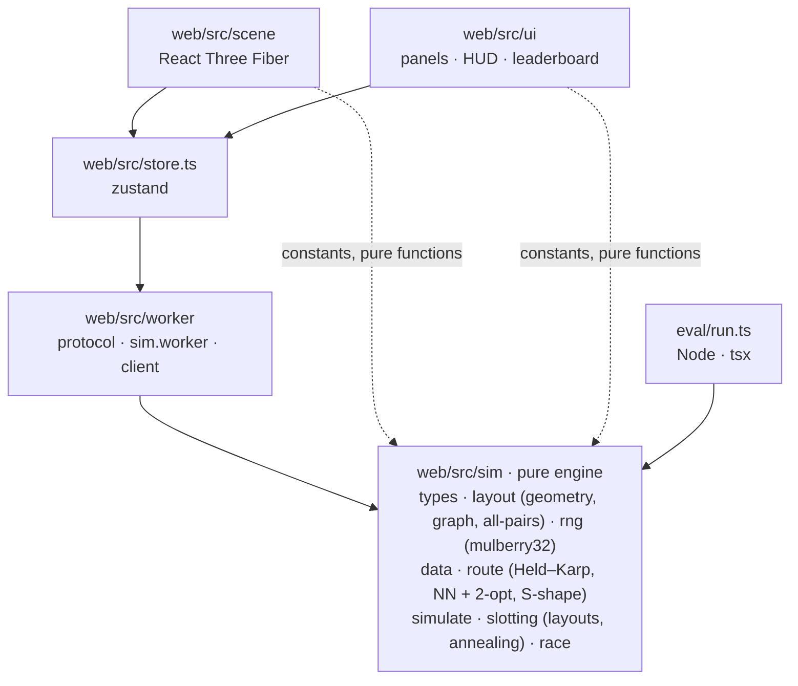
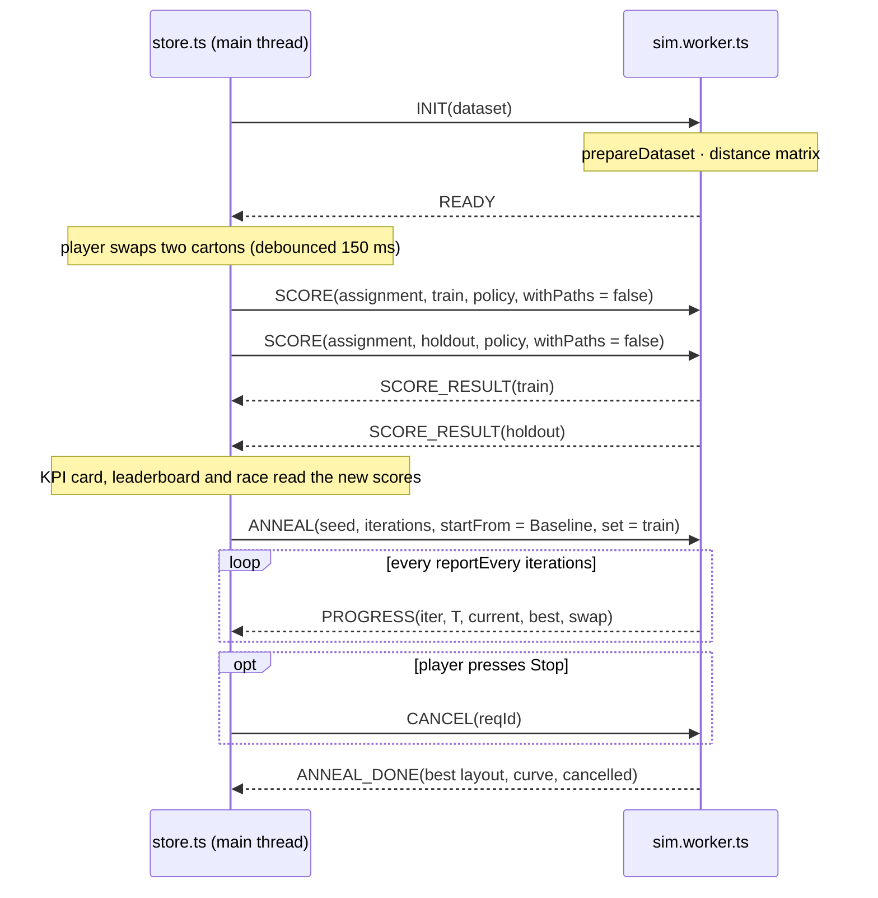

# Ghostwalk architecture

This page explains how the parts fit together, and why. The binding contract for each module is [BUILD_SPEC.md](BUILD_SPEC.md). Where this page and the code disagree, the code wins and this page is the bug.

## Principles

1. **One simulator.** The engine in `web/src/sim/` is pure TypeScript with no DOM, React or three.js. The browser runs it in a Web Worker, and `npm run eval` runs the same files in Node. The 3D picker never computes a route: it plays back `OrderScore.path` from `simulate()`. So what you watch, what the KPI card shows and what `eval/results.md` reports are the same numbers.
2. **Measured on orders the layout never saw.** Train orders (1–15 Nov 2011) drive the player's choices, the heatmap and the optimiser. Held-out orders (16–30 Nov) are used only for scoring.
3. **Deterministic.** The simulator never calls `Math.random()` or `Date.now()`. Random layouts and annealing use `mulberry32(seed)`. The annealing budget is counted in iterations, so a seed reproduces the same layout on any machine. Wall-clock time is reported as a measurement, never used as an input.
4. **Walking follows aisles.** Every metre is a sum of edge lengths on the aisle graph. No route cuts through a rack.

## Module map



Import rules (enforced by review): `sim/` imports nothing from React, the DOM or three. `worker/` imports only `sim/`. `scene/` and `ui/` may import pure functions and constants from `sim/`, plus the store. Only the store talks to the worker.

| Path | Responsibility | Owner |
|---|---|---|
| `data/prepare.py` | UCI workbook → `orders.json` | done before the build |
| `web/src/sim/` | geometry, routing, scoring, layouts, annealing | Anand (#1, #2) |
| `web/src/worker/` | runs the engine off the main thread | Anand (#3) |
| `web/src/scene/` | the 3D scene | Anand (#4) |
| `web/src/ui/`, `store.ts`, `App.tsx` | panels, HUD, app state | Anand (#5); `ui/Leaderboard.tsx` + `ui/leaderboardModel.ts`: Junaid (#8) |
| `eval/run.ts` | headless evaluation → `eval/results.md` | Anand (#2) |
| `README.md`, `DEV_LOG.md`, `docs/`, `scripts/` | documentation, generated diagrams, pitch | Junaid (#9, #10, #11) |

## Data contract

`data/prepare.py` writes `web/public/data/orders.json`:

```ts
{
  meta: { source, doi, licence: "CC BY 4.0", month: "2011-11", topSkus: 100,
          split: { rule, train, holdout }, cleaning: string[], stats: {...},
          orderCount, lineCount, linesPerOrderHistogram },
  products: [{ sku, desc, rank, picks, picksTrain, picksHoldout, qty }], // rank 1 = most picked
  orders:   [{ id, ts: "2011-11-03T10:12:00", split: "train" | "holdout", lines: [{ sku, qty }] }]
}
```

`prepareDataset()` maps each SKU string to its product index (0–99, in array order) and keeps orders in chronological order. A layout is an **assignment**: `Uint8Array(100)` with `assignment[skuIdx] = slotId`. It is always a permutation, so every SKU has exactly one slot.

## Geometry and the walking graph

The full declaration is in the [README](../README.md#warehouse-layout-declared) and in `web/src/sim/layout.ts`. Both the floor plan image and the README table are generated from that file.

- **66 nodes:** the dock, plus 13 per aisle: front junction, bays 0–4, middle junction, bays 5–9, back junction. Both rack sides of a bay share one node, because the picker stands in the aisle and turns left or right.
- **Edges:** along each aisle; between neighbouring junctions on the front, middle and back cross-aisles; and from the dock to aisle 0's front junction. Lengths are the axis-aligned distances.
- **All-pairs shortest paths:** Dijkstra from every node, run once at module load (66 × 66, trivially cheap). It also stores a predecessor table, so `pathBetween(u, v)` expands any leg into the edge-by-edge node path the picker walks.

## Routing an order

For an order, the engine collects the distinct bay nodes of its SKUs' slots (the stops), then finds the shortest closed tour `dock → stops → dock` on the distance matrix.

- **Exact (Held–Karp).** `dp[mask][j]` is the shortest walk that leaves the dock, visits exactly the stops in `mask` and ends at stop `j`. The tour cost is `min_j dp[full][j] + d(j, dock)`. With *n* stops this takes O(2ⁿ · n²) time and O(2ⁿ · n) memory: for n = 11 that is 2,048 × 11 states and about 250k transitions, under a millisecond. The DP lives in one flat `Float32Array`. Exact routing is used when n ≤ 11 (12 nodes including the dock).
- **Heuristic (n > 11).** Nearest-neighbour construction, then 2-opt until no improving move is left. These orders are flagged `exact: false`, and the Evidence panel reports their count and share of metres.
- **S-shape (ablation).** The traversal policy from Hall (1993), close to what a human picker does. Enter every aisle that holds a pick and walk it end to end; on the last aisle, return. It shows how much of the gain comes from routing rather than slotting. By construction it can never be shorter than the exact tour (a unit test checks this on every order).

`tourPath()` turns the stop order into a node path through `pathBetween`, so consecutive nodes are always graph edges (another unit test checks this). Time per order is `metres / 1.2 + 8 × lines`.

## Layouts

| Layout | Rule |
|---|---|
| Original | catalogue order: SKUs sorted by StockCode fill slots 0, 1, 2, … aisle by aisle |
| Random (seed 42) | `mulberry32(42)` Fisher–Yates permutation; a reference row so no convention is convenient |
| Baseline | the problem statement's "fast movers nearest the dock": SKUs ranked by **train** picks, slots ranked by graph distance from the dock, rank *k* SKU → rank *k* slot, ties broken by slot id |
| SA | simulated annealing from Baseline on train orders (below) |
| You | whatever the player builds, starting from Original, Baseline or SA |

## Simulated annealing

- **Move:** swap the slots of two SKUs.
- **Objective:** total exact-routed metres over the **train** orders. It never sees held-out orders.
- **Incremental delta:** an inverted index maps each SKU to the train orders that contain it. A swap re-routes only the orders that contain either SKU, using a per-order cost cache, instead of all ~1,100 train orders. A test (`verifyIncremental`) checks that the running total always equals a full recompute.
- **Temperature:** T₀ is set so a median uphill move is accepted with probability ½ (T₀ = median |Δ| of 200 probe swaps / ln 2). It then cools geometrically to T₀ / 1000 over the iteration budget: T(k) = T₀ · 1000^(−k / iterations). Acceptance is Metropolis, exp(−Δ / T). The best-so-far layout is kept.
- **Reproducible:** the seed and the iteration count fully determine the result. `npm run eval` ships seed 42 × 30,000 iterations as `web/public/layouts/sa_seed42.json` and reports mean ± sd over 5 seeds.
- **Live:** every `reportEvery` iterations the worker posts progress (iteration, temperature, current, best, last accepted swap), so the scene can fly the two cartons and the curve can grow.

## Worker protocol

The main thread never runs a full re-score. Messages are typed in `web/src/worker/protocol.ts`:



`withPaths = false` drops the per-order node paths from KPI scoring, which keeps messages small. Replay and race ask for the paths of only the orders they animate.

## Render loop

- The scene draws `displayAssignment(state)`: the live SA layout while annealing, otherwise the player's.
- The picker and ghost move in `useFrame` with refs. Per-frame distance and time go into the mutable `liveCounters` object, which the HUD reads in `requestAnimationFrame`. Nothing per-frame goes through React state.
- Racks and cartons are `InstancedMesh`es, and labels are drawn only for hovered, selected and top-10 cartons. The budget is ≤ 60 draw calls at 60 fps on an integrated GPU. Bloom is opt-in (High quality).

## Evaluation pipeline

`npm run eval` (from `web/`) runs `eval/run.ts` under `tsx`. It loads `orders.json` and scores Original, Random (42), Baseline and SA on train and held-out, plus the S-shape ablation. It runs SA (seed 42, 30,000 iterations, from Baseline) and 5 more seeds for mean ± sd, and measures milliseconds per full re-score. It writes:

- `eval/results.md`, the human-readable tables with the commit hash. `scripts/sync-readme.ts` copies them into the README, and the deck builder reads `eval/results.json`.
- `eval/results.json`, the same numbers, machine-readable.
- `web/public/layouts/sa_seed42.json`, the shipped SA layout and its curve, which the app loads as the SA reference.

## Leaderboard (stretch S3)

`web/src/ui/Leaderboard.tsx` is a self-contained panel. It reads the store and never writes to it. Its logic is in `web/src/ui/leaderboardModel.ts`, which is pure and unit-tested in `web/tests/leaderboardModel.test.ts`.

- **Rows:** Baseline and SA are reference rows, computed live from the store's scores. Saved player layouts are ranked with them by held-out km. The unsaved layout on the floor shows as "You (unsaved)" so players see where it would land.
- **No stale scores:** Save is enabled only when (a) the player's held-out score arrived after the latest layout change, (b) it matches the current routing policy, and (c) no scoring request is in flight. This relies on the store's contract that `scores.player` belongs to the current `assignment` once `scoring` is false, which the KPI card relies on too.
- **Comparable rows only:** each entry stores its policy and a dataset fingerprint (`month | orders | lines | train/holdout`). Entries from another policy or dataset are hidden and counted, never mixed into the ranking.
- **Storage:** `localStorage` key `ghostwalk.leaderboard.v1`, capped at 50 entries. Every read and write is in try/catch (storage can be missing, blocked or full). Stored rows are validated, and the assignment must be a permutation of 0–99. Ids are re-derived from layout + policy, so saving the same layout twice updates one row.
- **Export JSON:** a self-describing file with the dataset fingerprint, the SKU list in index order, the slot-id scheme, the commit hash and every entry's full assignment. Anyone can re-score an exported layout with the same engine.

## Tests

`npm run test` (Vitest, in `web/tests/`) covers:

- Held–Karp equals brute force on 200 random stop sets with n ≤ 7.
- Every tour path uses graph edges only.
- Hand-checked distances: dock → first bay of aisle 0 = 4.0 + 2.6 = 6.6 m; first bay of aisle 0 → first bay of aisle 1 = 2.6 + 5.0 + 2.6 = 10.2 m.
- `simulate` is deterministic.
- Baseline puts the top-ranked SKU in the slot nearest the dock.
- The incremental annealing total equals a full recompute.
- S-shape is never shorter than exact.
- The leaderboard model: validation, ranking, the capacity cap, storage failures and the export format.
